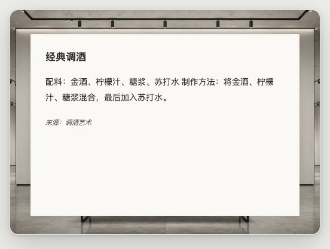

# 知涟 WaitWiki

等待时，读一点有意思的知识。Chrome Manifest V3 扩展，当前版本 **1.3.0**。

在支持的 AI 网页按 Enter 后显示知识内容；默认 10 秒收起，也可选择 20 秒或常驻。右下角入口可手动打开，悬停后的收起按钮或点击外部可关闭。



## 这次更新

- **默认保持纯色阅读界面**；可在设置中开启 ArtDuo 展厅背景。
- 内置与 ArtBreeze 相同的 **24 个展厅**，图片合计 886,902 字节（约 866 KiB），不用下载背景或依赖 CDN。
- 场景可自动稳定匹配，或固定选择。阅读内容放在不透明阅读面上，长文可滚动，背景不妨碍正文辨认。
- 白天、夜间、跟随系统三种光线模式；升级时保留旧版明确选择的暗夜设置。
- 保留九类内容、来源信息、圆形入口、展示时长、原有阅读大小、缓存和预加载。
- 工具仅在悬停或键盘焦点进入阅读区域时显示；新增收起按钮，区域内可按 Esc。
- 支持减少动态效果、小窗口适配及背景失败时的素色回退；升级不会重置原有偏好。

展厅背景本地可用，百科等在线内容仍依赖原有服务；本地精选数据、偈语和已有缓存继续可用。

## 安装与使用

1. 克隆本仓库，或将发布 ZIP 解压到独立目录。
2. 在 Chrome 扩展程序页面开启“开发者模式”。
3. 选择“加载已解压的扩展程序”，选中含 `manifest.json` 的目录。
4. 在支持的 AI 网页输入并按 Enter；更新后重新加载扩展和网页。

支持 ChatGPT、Claude、Gemini、Kimi、DeepSeek、Copilot / Bing、Grok、豆包、元宝等；页面注入只覆盖清单中的 AI 站点。站点 DOM 的后续变化可能影响原有 Enter 识别。

此扩展保留网页触发与固定展示时长，不接入 InIsle 的 CLI Hook，也不把定时收起视为模型真实完成信号。

## 设置

| 设置 | 行为 |
| --- | --- |
| 启用知涟 | 控制入口与知识展示 |
| 显示来源信息、圆形入口 | 保留原有显示开关 |
| 展示时长 | 10 秒 / 20 秒 / 常驻 |
| 纯色阅读界面大小 | 保留原有小 / 中 / 大 |
| 展厅背景 | 默认关闭，可主动开启 |
| 场景 | 自动匹配或固定 24 个场景之一 |
| 光线 | 跟随系统 / 白天 / 夜间 |
| 展厅大小 | 背景开启时的整体空间大小 |

内容类型包含维基百科、名言、趣闻、建议、动物、问答、调酒、数据真相和偈语。至少保留一类；来源链接保留原始出处并在新标签打开。

## 开发与发布包

需要 Node.js 18+ 和 Python 3；不需要安装 npm 依赖。

```bash
npm run check
npm run preview -- --port 8768
npm run build
```

- 检查覆盖场景完整性、哈希、确定性匹配、居中布局、窗口边界及旧设置迁移。
- 本地预览加载真实界面代码，使用模拟 Chrome API、百科内容与原有本地精选内容；不安装扩展、不读取真实聊天。
- 发布包为 `dist/waitwiki-1.3.0.zip`，包含运行文件、两份精选 CSV、图标与 24 个场景。
- `data/` 下的研究资料、旧的 `chrome_store/` 副本、测试与 Git 数据不进入发布包。原始研究文件继续留在源码仓库；请使用构建产物提交审核。

本轮未提交 Chrome 商店。商店截图、权限及隐私披露、素材再分发权仍需在正式上架前核对，参见 [验证与发布说明](docs/2026-10-27-gallery-verification.md)。

## 共用场景模块

`gallery/` 是 [ArtBreeze](https://github.com/astroleno/artbreeze) 维护的同版本副本，运行时完全本地。同步后在两边执行检查：

```bash
python3 scripts/sync-gallery.py --from /path/to/artbreeze/gallery
npm run check
```

两个产品各自带完整资源，避免一个仓库更新导致另一个产品依赖断裂。每个场景的来源、稳定 ID、挂画区域与 SHA-256 可在 `gallery/scenes.json` 查看。

[模块设计](docs/gallery-design.md) · [场景素材来源](gallery/SOURCES.md) · [隐私政策](privacy.md)

## 内容与许可

代码沿用原项目的 MIT 许可声明。Wikipedia、公开知识 API、原有本地精选内容与 ArtDuo 场景分别保留其来源；代码许可不自动授予这些内容独立再分发许可。请保留产品中的来源信息。
